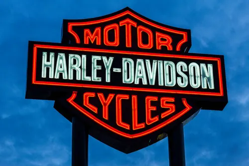

# Harley-Davidson: historia y pasión por las motos

## Introducción

Harley-Davidson es una **marca estadounidense de motocicletas** fundada en 1903 en Milwaukee, Wisconsin. Es conocida por sus motos de estilo clásico, sus motores y su importancia dentro de la *cultura motera*.

Una de las cosas que más me gustan de Harley-Davidson es que sus motos tienen mucha personalidad y un estilo que se reconoce fácilmente.

La marca también es conocida por sus motores `V-Twin`, utilizados en muchas de sus motocicletas.

## Historia de Harley-Davidson

Harley-Davidson comenzó en 1903 gracias a William S. Harley y Arthur Davidson. Con el tiempo, la empresa fue creciendo hasta convertirse en una de las marcas de motos más conocidas del mundo.

### Momentos importantes

1. En 1903 se fundó Harley-Davidson en Milwaukee.
2. En sus primeros años comenzó a fabricar y vender motocicletas.
3. Durante el siglo XX se convirtió en una marca muy reconocida.
4. Actualmente sigue fabricando motocicletas de diferentes estilos.

## Características de las motos Harley-Davidson

Algunas de sus características más conocidas son:

- Diseños clásicos y personalizados.
- Motores de gran cilindrada en muchos modelos.
- Gran variedad de accesorios.
- Cultura motera y concentraciones.
- Modelos preparados para viajar largas distancias.

## Modelos conocidos

| Modelo | Tipo de moto | Característica principal |
|---|---|---|
| Sportster S | Sport | Diseño deportivo |
| Street Bob | Cruiser | Estilo minimalista |
| Fat Boy | Cruiser | Diseño robusto |
| Road Glide | Touring | Preparada para viajar |

## Ejemplo de código

Como esta práctica pertenece a la asignatura de informática, voy a poner un pequeño ejemplo en Python que muestra varios modelos de Harley-Davidson.

```python
motos = ["Sportster S", "Street Bob", "Fat Boy", "Road Glide"]

for moto in motos:
    print("Modelo Harley-Davidson:", moto)
```

Este programa recorre una lista de motocicletas y muestra sus nombres en pantalla.

## Imagen local de Harley-Davidson

Esta imagen está guardada dentro de la carpeta `assets` de mi repositorio.



## Imagen externa de Wikimedia Commons

[IES CLARA DEL REY](https://commons.wikimedia.org/wiki/File:I.e.s._clara_del_rey_(Prosperidad,_Madrid).jpg)

Esta fotografía pertenece a Wikimedia Commons y muestra una motocicleta Harley-Davidson.


Fotografía de M62, publicada en Wikimedia Commons con licencia Creative Commons Attribution-ShareAlike.

[Consultar la información y licencia de la fotografía]([https://commons.wikimedia.org/wiki/File:Harley-Davidson.jpg](https://commons.wikimedia.org/wiki/File:I.e.s._clara_del_rey_(Prosperidad,_Madrid).jpg))

## Enlaces de interés

- [Página oficial de Harley-Davidson](https://www.harley-davidson.com/es/es/index.html)
- [Más información sobre Harley-Davidson](docs/detalles.md)

## Conclusión

Harley-Davidson es una marca que destaca por su historia, sus diseños y su relación con el mundo de las motocicletas.

Con esta práctica también he aprendido a utilizar Markdown para organizar información, insertar imágenes, crear tablas y añadir enlaces dentro de un repositorio de GitHub.
  
